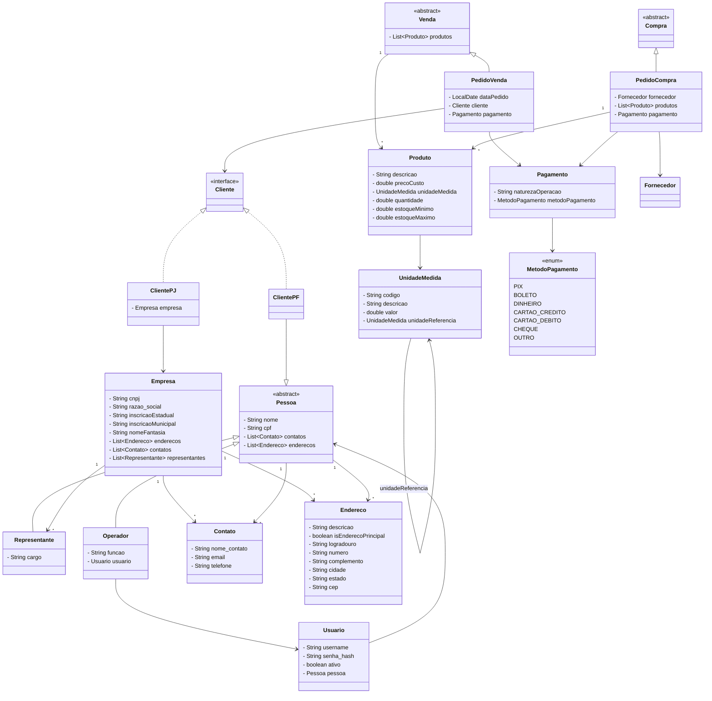

# Procer Pedidos de Vendas

Sistema de gestão de pedidos de vendas.

## Diagrama de Classes



## Estrutura do Projeto

```
model/
├── Pessoa.java          (abstract) — base para pessoas físicas
├── Representante.java   — estende Pessoa, representa empresa
├── Operador.java        — estende Pessoa, usuário interno do sistema
├── Usuario.java         — credenciais de acesso
├── Cliente.java         (interface) — base para clientes PF e PJ
├── ClientePF.java       — cliente pessoa física (extends Pessoa, implements Cliente)
├── ClientePJ.java       — cliente pessoa jurídica (implements Cliente)
├── Empresa.java         — empresa com CNPJ e representantes
├── Contato.java         — email e/ou telefone de contato
├── Endereco.java        — endereço completo
├── Produto.java         — produto com preço de custo, estoque e unidade de medida
├── UnidadeMedida.java   — unidade de medida com suporte a conversão (auto-referência)
├── Venda.java           (abstract) — base para operações de venda
├── PedidoVenda.java     — estende Venda, pedido com produtos e cliente
├── Compra.java          (abstract) — base para operações de compra
├── PedidoCompra.java    — estende Compra, pedido com fornecedores e produtos
├── Fornecedor.java      — fornecedor de produtos
├── Pagamento.java       — natureza e método de pagamento
└── MetodoPagamento.java (enum) — PIX, BOLETO, DINHEIRO, CARTÃO, CHEQUE, OUTRO

service/
└── CalcularPrecoVendaProdutoService.java — calcula o preço de venda de um produto
```