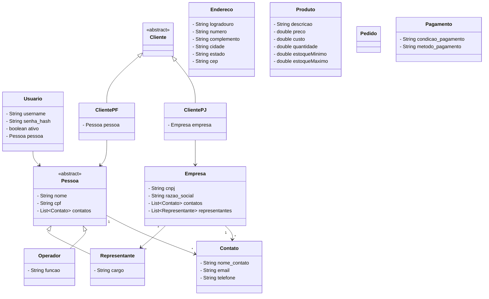

# Procer Pedidos de Vendas

Sistema de gestão de pedidos de vendas.

## Diagrama de Classes



## Estrutura do Projeto

```
model/
├── Pessoa.java          (abstract) — base para pessoas físicas
├── Representante.java   — representa empresa no sistema
├── Operador.java        — usuário interno do sistema
├── Usuario.java         — credenciais de acesso
├── Cliente.java         (abstract) — base para clientes PF e PJ
├── ClientePF.java       — cliente pessoa física
├── ClientePJ.java       — cliente pessoa jurídica
├── Empresa.java         — empresa com CNPJ e representantes
├── Contato.java         — email e/ou telefone de contato
├── Endereco.java        — endereço completo
├── Produto.java         — produto com preço, custo e estoque
├── Pedido.java          — pedido de venda
└── Pagamento.java       — condição e método de pagamento
```